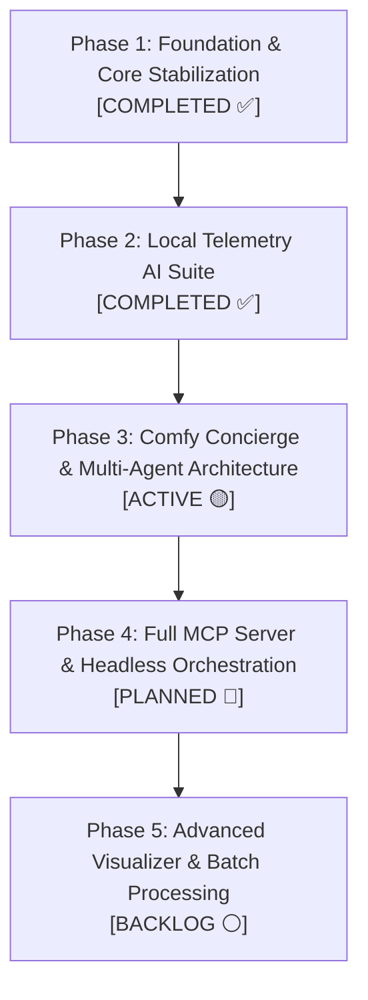

# PME-ComfyEW Platform Roadmap 🗺️

> **Engineering Workbench for Telemetry, Signal Analysis, and Simulation Workflows**  
> Based on the ComfyUI visual graph engine, tailored for Pratt Miller Engineering.

---

## 1. Platform Vision & Core Principles

**PME-ComfyEW** transforms node-based visual programming into a high-performance engineering environment for motorsport, robotics, and defense vehicle dynamics telemetry.

### Core Tenets & Constraints
* 🚫 **Strict Generative AI Prohibition:** No image/video diffusion models, checkpoints, samplers, or media generation workflows. The runtime is dedicated strictly to numerical data, timeseries analysis, signal processing, and engineering reporting.
* 📦 **Zero-Bloat Dependency Policy:** All custom nodes and backend bridges prioritize the Python standard library and pre-approved workspace packages (`numpy`, `scipy`, `pandas`, `h5py`, `matplotlib`). No unapproved pip installations.
* 🔌 **Provider-Agnostic AI Architecture:** AI assistant capabilities must remain vendor-neutral, supporting local CLI bridges (Gemini/Antigravity), local inference servers (Ollama, vLLM, LM Studio), and commercial APIs (Claude, OpenAI) interchangeably.
* 🧩 **Modular Sub-Repository Design:** Specialized toolsets (e.g., `timeseries-nodes`, `python-calcs`, `pme-gemini-nodes`) are housed in independent sub-repositories under `custom_nodes/` for clean versioning and independent release cycles.

---

## 2. Phased Development Roadmap



---

### Phase 1: Foundation & Core Stabilization ✅ `COMPLETED`
*Goal: Ensure robust, crash-free execution of the ComfyUI engine with zero dependency on diffusion components.*

- [x] **Upstream Analysis & Git Sync:** Analyzed differences with upstream ComfyUI; safely pulled core engine optimizations while preserving engineering nodes.
- [x] **Execution Loop Stabilization:** Resolved dynamic prompt queue exceptions and unhandled worker shutdown edge cases in `execution.py` and `server.py`.
- [x] **Zero-Dependency Math Expression Node:** Implemented `ComfyMathExpression` in pure standard library Python (`ast.parse`) with strict security sandboxing (disallowing `__import__`, `eval`, or arbitrary attribute access).
- [x] **Clean Submodule Boundaries:** Configured root `.gitignore` to support nested custom node repositories without git tracking collision.
- [x] **Root Milestone:** Committed & pushed to `origin/master` (`commit 1f61c523`).

---

### Phase 2: Local Telemetry AI Suite (`pme-gemini-nodes`) ✅ `COMPLETED`
*Goal: Build dedicated, non-generative nodes that process telemetry signals via the local Gemini CLI (`agentapi`).*

- [x] **Dedicated Repository Scaffold:** Initialized git repository in [`custom_nodes/pme-gemini-nodes/`](custom_nodes/pme-gemini-nodes/).
- [x] **Subprocess Backend Bridge (`gemini_backend.py`):** Non-interactive execution of local `agentapi.bat` with zero external pip dependencies.
- [x] **Telemetry Distillation Engine:** Converts dense multi-channel timeseries arrays into compact statistical summaries (sample rate, channel boundaries, min/max/mean/std) to prevent token exhaustion.
- [x] **Node 1: Gemini Data Insights (`PME_DataInsightsNode`):**
  - Category: `scripting/ai-gemini-DataInsights`
  - Modes: *General Analysis*, *Anomaly & Outlier Detection*, *Threshold Violation Audit*, *Root-Cause Hypothesis*, *Run-to-Run Comparison*.
  - Outputs: `insights_text`, `flagged_anomaly` (boolean trigger), and `key_metrics`.
- [x] **Node 2: Gemini Py/Math Gen (`PME_PyMathGenNode`):**
  - Category: `scripting/ai-gemini-PyMathGen`
  - Formats: *Python Script (python-calcs)*, *ComfyMathExpression*, *NumPy Vectorized*, *Pandas Series*.
  - Automatically strips markdown code fences for direct routing into `PythonCalcNode`.
- [x] **Node 3: Gemini Report Gen (`PME_ReportGenNode`):**
  - Category: `scripting/ai-gemini-Report`
  - Formats: *Markdown (.md)*, *HTML Document (.html)*, *Executive Summary*, *Jira Note*.
  - Auto-persists timestamped reports to `E:\PME-ComfyEW\output\`.
- [x] **Automated Test Coverage:** Authored [`test_gemini_nodes.py`](custom_nodes/pme-gemini-nodes/test_gemini_nodes.py) (8 unit tests, 100% pass rate).
- [x] **Comprehensive Documentation:** Authored visual guide in [`custom_nodes/pme-gemini-nodes/README.md`](custom_nodes/pme-gemini-nodes/README.md).

---

### Phase 3: Comfy Concierge & Multi-Agent Architecture ✅ `COMPLETED`
*Goal: Develop an overarching, graph-aware GUI assistant (Feature 4) with an open-ended multi-agent provider backend.*

- [x] **1. Provider-Agnostic Agent Adapter (`concierge_providers.py`):**
  - [x] `BaseAgentProvider` abstract interface.
  - [x] `GeminiCliProvider`: Uses local `agentapi` CLI (Default / Antigravity pair).
  - [x] `OpenAICompatibleProvider`: Universal adapter for local inference servers (**Ollama**, **vLLM**, **LM Studio**, **LocalAI**) and OpenAI endpoints using standard library HTTP (`urllib.request` / `aiohttp`).
  - [x] `AnthropicProvider`: Direct Claude 3.5/3.7 integration via standard HTTP.
  - [x] `ProviderConfig`: Persistent configuration in `concierge_config.json`.
- [x] **2. MCP-Ready Engineering Tool Engine (`concierge_tools.py`):**
  - [x] `inspect_active_graph()`: Serializes node types, connections, missing inputs, and disconnected outputs.
  - [x] `diagnose_execution_error()`: Captures runtime exceptions from `PythonCalcNode` or telemetry loaders and synthesizes root-cause remedies.
  - [x] `lookup_node_catalog()`: Searches available node definitions and slot schemas.
- [x] **3. Backend REST Bridge (`concierge_server.py`):**
  - [x] Register endpoints in `PromptServer.instance.routes`:
    - `POST /pme/concierge/chat`: Conversation streaming & message handling.
    - `POST /pme/concierge/inspect-graph`: Canvas topology analysis.
    - `GET/POST /pme/concierge/config`: Provider selection & endpoint URLs.
    - `GET /pme/concierge/nodes`: Live catalog query.
- [x] **4. ComfyUI Web Frontend Extension (`web/concierge.js`):**
  - [x] Sleek, collapsible side-drawer / floating panel in ComfyUI interface.
  - [x] One-click **"Inspect Active Canvas"** button.
  - [x] Model & Provider switcher dropdown (Gemini CLI, Ollama, Claude, OpenAI).
  - [x] Markdown chat interface with instant code-copying.
- [x] **5. Test Suite & Verification (`test_concierge.py`):**
  - [x] Complete unit test suite verifying provider adapters, graph topology serialization, and error diagnostics.

---

### Phase 4: Full MCP Server & Headless Orchestration 🔵 `PLANNED`
*Goal: Expose ComfyUI's canvas and execution engine as an official Model Context Protocol (MCP) server.*

- [ ] **ComfyUI MCP Server Implementation:**
  - Standard JSON-RPC 2.0 server over stdio or SSE.
  - Expose tools: `comfy_get_graph`, `comfy_add_node`, `comfy_connect_pins`, `comfy_execute_workflow`, `comfy_get_results`.
- [ ] **IDE & External Agent Integration:**
  - Connect external AI agents (Antigravity, Cursor, Claude Code, custom CLI scripts) directly to a live running ComfyUI instance.
  - Allow external scripts to load a workflow template, populate parameter values, trigger execution, and collect telemetry plots.
- [ ] **Automated Workflow Regression Testing:**
  - Continuous validation test suite verifying that complex telemetry graphs run and produce expected outputs without UI interaction.

---

### Phase 5: Advanced Visualizer & Batch Processing ⚪ `BACKLOG`
*Goal: Supercharge telemetry rendering speed and automated track-side processing.*

- [ ] **High-Rate Timeseries Plotter (WebGL / WebGPU):**
  - Enable smooth panning and zooming on 10M+ sample telemetry files without UI lag.
- [ ] **Multi-Graph Synchronized Cursors:**
  - Cross-hair time-sync across separate XY plotters (e.g., synchronizing Throttle, Brake, Steering, and Lateral Accel).
- [ ] **Pratt Miller Vehicle Dynamics Calc Library:**
  - Out-of-the-box verified calculation templates in `python-calcs/scripts/` (slip angles, tire wear models, damper velocity histograms, aero balance).
- [ ] **Headless Batch Runner CLI:**
  - Folder-watcher utility to automatically run incoming session files (`.mat`, `.mdf4`, `.csv`) through configured Comfy pipelines and export reports.

---

## 3. Architecture Overview

```
E:\PME-ComfyEW\
├── main.py                     # Primary workbench entrypoint
├── nodes.py                    # Core node registration & discovery
├── execution.py                # Graph execution engine
├── server.py                   # Async HTTP / WebSocket prompt server
├── ROADMAP.md                  # Development roadmap and tracking (this document)
├── README.md                   # Main workbench setup & architecture guide
│
└── custom_nodes/
    ├── timeseries-nodes/       # Ingests, slices, and plots timeseries channels
    ├── python-calcs/           # Dynamic Python calculation engine & scripts
    └── pme-gemini-nodes/       # Engineering AI nodes & Comfy Concierge (Dedicated Git Repo)
        ├── gemini_backend.py   # CLI bridge & telemetry summarizer
        ├── data_insights_node.py
        ├── py_math_gen_node.py
        ├── report_gen_node.py
        ├── concierge_providers.py  # [Phase 3] Multi-agent provider adapters
        ├── concierge_tools.py      # [Phase 3] Graph & error diagnostic tools
        ├── concierge_server.py     # [Phase 3] PromptServer REST endpoints
        ├── web/js/                 # [Phase 3] ComfyUI frontend sidebar
        └── test_gemini_nodes.py    # Automated test suite
```

---

## 4. Release History & Milestones

| Date | Milestone / Commit | Description | Status |
| :--- | :--- | :--- | :--- |
| **2026-11-11** | `1f61c523` | Core stability fixes & `ComfyMathExpression` zero-dependency node. | **Shipped** |
| **2026-11-11** | `208ce3f` | Initial release of `pme-gemini-nodes` (DataInsights, PyMathGen, ReportGen). | **Shipped** |
| **2026-11-11** | `4f9861b` | Comprehensive documentation & wiring diagrams for `pme-gemini-nodes`. | **Shipped** |
| **2026-11-11** | `da0475eb` | Updated root `README.md` cross-referencing AI node documentation. | **Shipped** |
| **2026-11-11** | *In Progress* | Phase 3: Comfy Concierge provider-agnostic sidebar & tools. | **Active** |

---

*Maintained by the Pratt Miller Engineering development team.*
